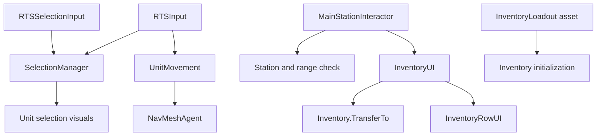

# Unity Project Analysis

Analysis date: 2026-11-03.

This document records a static inspection of the project's scripts, scene configuration, assets, packages, and input settings. Unity was not run and gameplay was not tested. The analysis itself did not modify project files.

## Overview

The project is an early 3D RTS prototype with a necromancy resource inventory system. Its existing gameplay foundation consists of unit selection, NavMesh movement, camera control, and inventory transfers between the main character and stations.

- Unity editor: `6000.6.7f1`.
- Rendering: Universal Render Pipeline (`17.6.0`).
- Navigation: AI Navigation (`2.0.16`) and `NavMeshAgent`.
- UI: uGUI and TextMesh Pro.
- Input System package: `1.20.1`, alongside legacy input.
- One enabled build scene: `Assets/Scenes/SampleScene.unity`.

## Folder organization

```text
Assets/
├── Scripts/
│   ├── Buildings/       Station inventory and interaction settings
│   ├── Core/            Inventory, loadouts, selection, camera
│   ├── RTS/             Mouse commands and selection input
│   ├── UI/              Inventory window and resource rows
│   └── Units/
│       ├── Common/      Selectable units and navigation
│       └── Main/        Main character station interaction
├── Scenes/              SampleScene and baked NavMesh data
├── Prefabs/UI/          InventoryRow prefab
├── ScriptableObjects/
│   └── Inventory/       Starting resource configurations
├── Settings/            URP renderers and volume profiles
├── Art/
├── Materials/
├── TextMesh Pro/
└── TutorialInfo/
```

## Script inventory

All 12 C# scripts found during inspection are under `Assets/Scripts`.

| Script | Responsibility |
| --- | --- |
| `Core/SelectionManager.cs` | Singleton storing selected units and control groups 0–9; updates unit selection visuals. |
| `RTS/RTSSelectionInput.cs` | Click selection, Shift selection, drag selection rectangle, and control group shortcuts. |
| `RTS/RTSInput.cs` | Right-click raycast; sends every selected unit to the hit position. |
| `Units/Common/Unit.cs` | Selectable unit component; exposes movement and toggles a selection visual. |
| `Units/Common/UnitMovement.cs` | Wraps `NavMeshAgent` with move, stop, and current-speed access. |
| `Core/RTSCameraController.cs` | Camera rig panning, orthographic zoom, and optional map bounds. |
| `Core/Inventory.cs` | Runtime resource counts, optional capacities, add/remove operations, and transfers with overflow refunds. |
| `Core/InventoryLoadout.cs` | ScriptableObject defining starting resource quantities. |
| `Buildings/Station.cs` | Station name, interaction range, and reference to its attached inventory. |
| `Units/Main/MainStationInteractor.cs` | Detects station clicks, checks distance, and opens the inventory window. |
| `UI/InventoryUI.cs` | Singleton managing the inventory window, two inventory columns, transfers, and row creation. |
| `UI/InventoryRowUI.cs` | Displays a resource count and binds transfer buttons for 1, 5, or all. |

## Gameplay systems

### Selection and control groups

`SelectionManager` owns the current selection and ten control groups. Selecting or deselecting a unit toggles its configured visual through `Unit.SetSelected`.

`RTSSelectionInput` supports individual selection and a screen-space drag rectangle. Shift-click toggles an individual unit; Shift-drag adds units. Box selection checks the screen position of each unit's transform, rather than its full rendered bounds.

### Movement

`RTSInput` raycasts from the main camera when the right mouse button is pressed. Every selected unit receives the same hit position through `UnitMovement.MoveTo`, which calls `NavMeshAgent.SetDestination`.

There is no formation or destination-spacing logic. Navigation data is stored in `Assets/Scenes/SampleScene/NavMesh-Plane.asset`.

### Camera

`RTSCameraController` moves the camera rig relative to its facing direction. It uses horizontal and vertical input axes for panning and changes the camera's orthographic size for zoom. Optional bounds clamp the rig's X/Z position; these bounds are disabled in the inspected scene.

### Resources and inventories

`ResourceType` defines `Corpse`, `Bones`, `Souls`, and `Blood`. Each `Inventory` stores runtime counts in a dictionary and can define a separate capacity for each resource. Missing capacities or values of zero or less mean unlimited storage.

`TransferTo` removes resources from the source, adds what fits to the destination, and refunds the remainder. `InventoryLoadout` assets provide initial quantities without storing runtime inventory state.

| Loadout asset | Configured resources |
| --- | --- |
| `InitialMainLoadout.asset` | 10 Blood and 10 Corpse |
| `StockPile.asset` | Zero Corpse and Blood |

The scene's main character has a loadout assigned. The test station has no loadout assigned, loadout initialization is disabled, and its inventory starts empty. Both scene inventories have no capacity limits configured.

### Station interaction and inventory UI

`MainStationInteractor` checks left-clicks for a station and compares the main character's position against the station's interaction range. When close enough, it opens `InventoryUI` with the character and station inventories.

The character does not need to be selected. Clicking a distant station logs a message; it does not move the character into range.

The window creates one row per resource for each inventory: eight rows in total. Buttons transfer 1, 5, or all available resources. Rows read their displayed counts every frame, and each transfer rebuilds all rows. Escape or the close button closes the window.

## Input handling

Project settings enable both legacy and newer input backends (`activeInputHandler: 2`). All custom gameplay scripts poll the legacy `UnityEngine.Input` API in `Update()`.

| Input | Behavior |
| --- | --- |
| WASD / arrow keys | Pan the camera |
| Mouse wheel | Change orthographic zoom |
| Left-click | Select a unit; also attempts station interaction |
| Left-drag | Box-select units |
| Shift-click | Toggle individual unit selection |
| Shift-drag | Add units to selection |
| Right-click | Move selected units |
| Ctrl + 0–9 | Assign a control group |
| 0–9 | Recall a control group |
| Escape / close button | Close the inventory window |

`Assets/InputSystem_Actions.inputactions` contains `Player` and `UI` maps. The Player map includes generic actions such as Move, Look, Attack, Interact, Crouch, Jump, Previous, Next, and Sprint. The inspected custom scripts do not consume these actions; their presence does not indicate implemented gameplay.

The scene's EventSystem uses `InputSystemUIInputModule` from the newer Input System.

## Scene composition

| Scene object | Relevant configuration |
| --- | --- |
| `RTSInput` | Holds `RTSSelectionInput`, `RTSInput`, and `SelectionManager`. |
| `MainChar` | Holds `Unit`, `UnitMovement`, `NavMeshAgent`, `Inventory`, and `MainStationInteractor`. |
| `Cube` | Test station named `StationTest`, with an inventory and a 2.5-unit interaction range. |
| `CameraRig` | Holds `RTSCameraController`; pan speed 20, zoom range 5–20, bounds disabled. |
| `UIManager` | Holds `InventoryUI`, wired to the window, title, close button, content containers, and row prefab. |
| `Canvas` | Contains inventory UI and the selection rectangle. |
| `EventSystem` | Processes UI input through `InputSystemUIInputModule`. |
| `Plane` | Ground with navigation setup. |

The scene also contains a main camera, directional light, and global volume. The reusable inventory row is stored at `Assets/Prefabs/UI/InventoryRow.prefab`.

## Architecture

The architecture is component-based and scene-driven. Inspector references connect scene objects, while `SelectionManager.Instance` and `InventoryUI.Instance` provide global access. The inspected scripts have no custom namespaces or assembly definitions and use Unity's default `Assembly-CSharp` assembly.



`Awake()` initializes cached components, singleton instances, capacities, and starting inventories. `Update()` handles input and displayed resource counts. There is no central command dispatcher, shared gameplay state machine, or inventory change-event system in the inspected code.

## Current limitations and potential issues

- Selection and station interaction independently handle left-clicks, so the same click can affect both systems.
- Selection and station interaction check whether the pointer is over UI; right-click movement does not.
- Control group handling is also skipped when the selection script returns early because the pointer is over UI.
- Movement raycasts have no ground-only layer mask. Click selection currently checks all layers, and no custom unit layer is configured.
- Box selection searches all units whenever a drag completes.
- Selected units share a single movement destination without formation logic.
- Inventory rows refresh counts every frame, and each transfer destroys and recreates all rows.
- Several scripts assume the main camera, singleton managers, and required component references exist.
- Station distance is checked when opening the inventory window; transfers do not recheck distance after it is open.
- Runtime resource counts and control groups have no persistence implementation.

These observations are based on code and serialized configuration, not reproduced runtime failures.

## Systems not found in the inspected custom scripts

No custom implementation was found for combat, enemies, health, summoning/necromancy actions, production, resource gathering, saving/loading, or progression. Installed packages and generic input actions should not be treated as evidence that these systems are implemented.
